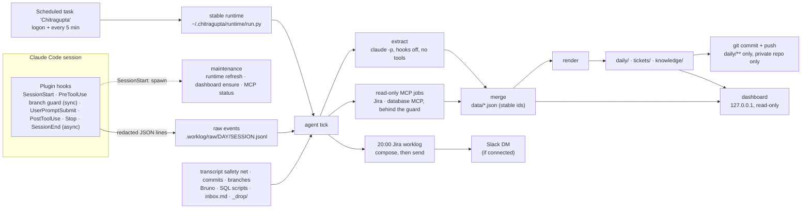

# Architecture

Chitragupta has five parts:

1. **Hooks** record events while you work. They are fast, never call a model and never touch the network.
2. **The tick** is a background job that turns those events into notes. It runs from the OS's scheduler (`chitragupta/scheduler.py`: Task Scheduler, launchd, a systemd user timer or cron; see [scheduling.md](scheduling.md)) and uses a stable copy of the engine.
3. **The data home** holds what the tick writes: plain Markdown and JSON.
4. **The dashboard** is a local server over the data home. It reads with GET, and writes only through a short allowlist of protected routes (settings and a few actions).
5. **The MCP server** (`chitragupta/mcpserver.py`) lets Claude Code sessions query the data home through 8 read-only tools. Claude Code starts it over stdio from `bin/cg-mcp`. See [mcp.md](mcp.md).

Everything is Python standard library code in one package, `chitragupta`. A few modules every part shares:

| Module | Does |
|---|---|
| `safety/` | the only code that starts a process, changes a file or opens a connection ([safety.md](safety.md)) |
| `configstore.py` | the one way `config.json` changes (setup, the engine, the dashboard): lock, backup, history, undo |
| `settings.py` | the schema and validation of every setting the dashboard may change |
| `searchidx.py` | the persistent search index (`.worklog/cache/search.sqlite`) for the dashboard, `/cg:search` and the MCP server ([search.md](search.md)) |
| `relations.py` | how a repo's base branches relate, and their read-only detection |
| `hostmcp.py` | PR data through a Git host's read-only MCP server |
| `share.py`, `scanlib.py` | team sharing and the deny-list / secret scan it gates on ([sharing.md](sharing.md)) |

## Data flow



### 1. Capture (hooks)

`hooks/hooks.json` registers six events and points them at `hooks/run.py` inside the plugin. The PreToolUse entry is the branch guard: it starts only for branch and PR creation commands (the hooks' `if` filter), reads a few small files, records nothing and finishes in well under 200 ms (see [branch-tracking.md](branch-tracking.md#the-guard)). Three rules apply to the others:

- **SessionStart runs synchronously.** It uses `py -3` with a 10 s budget; the measured p95 is well under 100 ms. It registers the session and prints context for the active ticket: a short summary from `cache/context/<KEY>.md`, a warning line if something is broken, and at most a weekly reminder. Then it spawns a detached maintenance process.
- **The other four events run asynchronously** with windowless `pyw -3`.
- **Every hook fails open.** Any error is logged and the hook exits 0, so a hook can never break a session.

Each event is redacted and appended to `.worklog/raw/<work day>/<session>.jsonl`. The ticket comes from the branch name, else from the prompt. Sessions inside the data home only get time-only events.

### 2. The tick

The `Chitragupta` scheduled task runs `agent tick --from-task` through the stable launcher at logon and then every 5 minutes; `--from-task` also starts the dashboard if it is not running. It runs hidden, never overlaps itself and has a 20-minute limit. One lock makes the tick the single writer. Each tick:

1. **Ingests** new raw events, plus the transcript safety net: Claude Code transcripts from the last 48 hours whose hooks didn't fire.
2. **Reads extra sources:** your commits in watched repos, Bruno request edits, SQL scripts, `inbox.md` lines and files in `_drop/`; then **branch tracking** (read-only git and the host CLI, no model): events, branches, parents, PRs and each active ticket's delivery check (see [branch-tracking.md](branch-tracking.md)).
3. **Extracts.** Once a session has enough new text and is idle, ended or 20 minutes old, it makes one `claude -p` call per chunk. Each call gets a redacted digest and returns structured JSON: findings, queries, APIs, tables, request calls, DB-flow steps and worklog lines. If the call fails, it backs off and writes a deterministic fallback summary.
4. **Merges** the results into `data/` with stable hash ids, so re-running never duplicates anything.
5. **Renders** the changed Markdown. Your `My notes` sections survive every re-render.
6. **Runs per-ticket features.** It curates the replayable request set (Bruno files, `requests.md`, `replay.sh`) and builds the DB-flow view and artifacts.
7. **Closes days** after `day_starts_at`. Closing consolidates the summary, the standup and the TODOs.
8. **Composes the evening Jira worklog** at `jira_worklog.send_at`, and sends it on Slack if connected.
9. **Runs MCP jobs**, within the daily budget, if configured.
10. **Commits and pushes** the allowlisted files.
11. **Housekeeping:** updates `health.json`, prunes raw files older than 30 days that are already processed, rotates logs, and writes the nightly backup zip if configured.

### 3. Model and MCP calls

- **Model calls** run as `claude -p` from `.worklog/sandbox`, built by one function (`safety/claude.py`): no tools, nothing pre-approved, `--permission-mode dontAsk`, no MCP servers, this plugin switched off (`enabledPlugins`), a fail-closed PreToolUse guard, no session persistence, and `CHITRAGUPTA_INTERNAL=1` set. The internal marker stops the hooks from recording the engine itself. Prompts ship in `chitragupta/prompts/`; a copy in `<home>/.worklog/prompts/` overrides one.
- **MCP jobs** each get one server, its read tools only, its write tools disallowed, and the fail-closed safety guard (profile `mcp`) that allows only single read statements on allowed connections. See [privacy.md](privacy.md#mcp-jobs) and [safety.md](safety.md).
- **Slack** sends run from `.worklog/slack-sender/`, where the Slack server is registered in local scope only, with `--strict-mcp-config` and only that server in `--mcp-config`; the guard (profile `slack-send`) lets only the send tool reach your own user ID.
- **Every side effect** (processes, file writes, network) goes through `chitragupta/safety/`, which checks it against an allowlist and logs every block to `%USERPROFILE%\.chitragupta\logs\security.log`. See [safety.md](safety.md).

### 4. Dashboard

`chitragupta/dashboard/` is a threaded `http.server` on `127.0.0.1`. It reads `data/`, the rendered files and `health.json`. Its only writes are the allowlisted routes in `dashboard/writes.py` (Origin and a per-start token checked, JSON only, size and rate limits): settings through `configstore`, and the actions in `dashboard/actions.py`. `dashboard/dbmap.py` builds the DB map. See [dashboard.md](dashboard.md).

## Runtime layout

The plugin folder moves on every plugin update. Anything that must keep working between sessions therefore calls a **stable runtime** instead. That covers the scheduled task, the data home's git pre-commit hook, the MCP guard and the generated `replay.sh`.

```
%USERPROFILE%\.chitragupta\          (CHITRAGUPTA_USER_DIR)
  home                               pointer: path of the data home
  runtime\
    run.py                           the launcher (copied from <plugin>\hooks\run.py)
    current                          the version run.py loads, e.g. 0.1.0
    0.1.0\chitragupta\               the engine package
    0.1.0\user-skill\                recall-skill template
    0.1.0\third_party\mermaid\       vendored Mermaid
  dashboard\<port>.token             shutdown token for the running dashboard
  maintenance.lock                   short-lived lock for the maintenance process
```

`run.py` has two jobs:

- **In the plugin**, it loads the package next to it.
- **In the runtime**, it loads `runtime/<current>/`.

Maintenance and setup refresh the runtime by copying into a temp folder and renaming it into place, then switching `current` atomically. They keep the newest two versions and never downgrade unless forced (`runtime install --force`).

Run any engine module through the launcher with `py -3 "%USERPROFILE%\.chitragupta\runtime\run.py" <module> [args]`. The modules are `agent`, `setup`, `doctor`, `cli`, `dashboard`, `redact`, `install`, `uninstall`, `runtime`, `plugin`, `migrate` and others.

## Data home layout

The default data home is `%USERPROFILE%\Chitragupta`. The file formats are stable, and changes come only with a forward migration that backs up first.

```
<home>\
  README.md  .gitignore  .gitattributes      pushed (with daily/)
  daily\YYYY\MM\YYYY-MM-DD.md                daily note (pushed)
  inbox.md                                   one line per note / worklog directive
  _drop\                                     files dropped here are filed into tickets
  tickets\INDEX.md
  tickets\<KEY>\README.md                    ticket hub: status, scenarios, findings, timeline, My notes
  tickets\<KEY>\queries.md  requests.md  replay.sh  db-flow.md  payloads\  artifacts\
  knowledge\apis.md  db-tables.md  db-map.md  integrations.md  branches.md
  bruno\                                     one Bruno collection, a folder per ticket; .env never read
  data\meta.json  catalog.json  generated.json  calendar.json  (branches.json: pre-0.2.0, kept as it was)
  data\git\<repo>\events.jsonl  branches.json  prs.json  patch-ids.json  repo.json   branch tracking
  data\days\YYYY\YYYY-MM-DD.json             per-day structured record
  data\tickets\<KEY>.json                    per-ticket structured record
  data\timesheets\YYYY-MM-DD.json            the evening worklog as composed / sent
  data\jira\  data\db-schema\  data\qa-trace\   MCP job caches (local only)
  .worklog\
    config.json  state.json  health.json  README.md
    raw\<day>\<session>.jsonl  raw\<day>\time\<session>.jsonl
    cache\  logs\  locks\  backups\  sandbox\  prompts\ (optional overrides)
    logs\ticks.jsonl                         the last 50 background runs: ok, error, skipped-busy, skipped-upgrade
    cache\condense\YYYY-MM-DD.json           condensed worklog lines (14 days), shared by the sender and the preview
    resend_requests.json                     ids of recent Resend requests (2-minute double-click window)
    mcp\allow.json  mcp\readonly-settings.json (for inspection)  mcp\slack.json  tmp\ (replay request bodies, 2 days)
    slack-sender\                            Slack's local-scope folder
    PAUSED                                   present while capture is paused
```

## Outside the data home

| Path | Written by |
|---|---|
| `~/.claude/skills/chitragupta/SKILL.md` | setup: the model-invoked recall skill |
| `~/.claude/CLAUDE.md` (block between `<!-- chitragupta:start -->` and `<!-- chitragupta:end -->`) | setup |
| Task Scheduler `\Chitragupta`, or the Startup-folder `Chitragupta.vbs` fallback (Windows); `~/Library/LaunchAgents/dev.chitragupta.tick.plist` (macOS); `~/.config/systemd/user/chitragupta.service` + `.timer`, or one crontab line marked `# chitragupta` (Linux) | setup |
| `<path>/shares/` of a folder share target; `<home>/share/<name>` clone of a team Git repo (commits and pushes of `shares/` only) | `/cg:share`, the dashboard's Share |
| `<home>\.git\hooks\pre-commit` | the tick: allowlist and redaction check |

`uninstall` removes everything in this table, including the data home's pre-commit hook when it calls the runtime. It also removes the runtime and the pointer.
