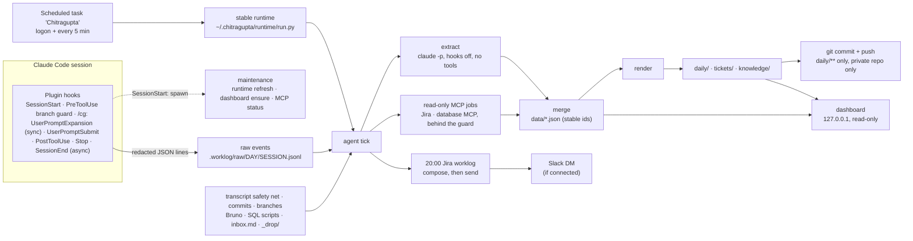

# Architecture

Chitragupta has five parts:

1. **Hooks** record events while you work. They are fast, never call a model and never touch the network.
2. **The tick** is a background job that turns those events into notes. It runs from the OS's scheduler (`chitragupta/scheduler.py`: Task Scheduler, launchd, a systemd user timer or cron; see [scheduling.md](scheduling.md)) and uses a stable copy of the engine.
3. **The data home** holds what the tick writes: plain Markdown and JSON.
4. **The dashboard** is a local server over the data home. It reads with GET, and writes only through a short allowlist of protected routes (settings and a few actions).
5. **The MCP server** (`chitragupta/mcpserver.py`) lets Claude Code sessions query the data home through 8 read-only tools. Claude Code starts it over stdio from `bin/cg-mcp`. See [mcp.md](mcp.md).

Everything is Python standard library code in one package, `chitragupta`. A few modules every part shares:

| Module | Does |
|---|---|
| `safety/` | the only code that starts a process, changes a file or opens a connection ([safety.md](safety.md)) |
| `configstore.py` | the one way `config.json` changes (setup, the engine, the dashboard): lock, backup, history, undo |
| `settings.py` | the schema and validation of every setting the dashboard may change |
| `searchidx.py` | the persistent search index (`.worklog/cache/search.sqlite`) for the dashboard, `/cg:search` and the MCP server ([search.md](search.md)) |
| `relations.py` | how a repo's base branches relate, and their read-only detection |
| `hostmcp.py` | PR data through a Git host's read-only MCP server |
| `share.py`, `scanlib.py` | team sharing and the deny-list / secret scan it gates on ([sharing.md](sharing.md)) |

## Data flow



### 1. Capture (hooks)

`hooks/hooks.json` registers seven events and points them at `hooks/run.py` inside the plugin. The PreToolUse entry is the branch guard: it starts only for branch and PR creation commands (the hooks' `if` filter), reads a few small files, records nothing and finishes in well under 200 ms (see [branch-tracking.md](branch-tracking.md#the-guard)). The UserPromptExpansion entry (`hook cg-expand`) starts only for the `/cg:` command names: it records that prompt's `prompt_id` in `.worklog/cache/cg-active/<session>` for the session guard, records nothing else, prints nothing and finishes in under 100 ms (see [safety.md](safety.md#how-it-is-enforced)). Three rules apply to the others:

- **SessionStart runs synchronously.** It uses `py -3` with a 10 s budget; the measured p95 is well under 100 ms. It registers the session and prints context for the active ticket: a short summary from `cache/context/<KEY>.md`, a warning line if something is broken, and at most a weekly reminder. Then it spawns a detached maintenance process.
- **The other four events run asynchronously** with windowless `pyw -3`.
- **Every hook fails open.** Any error is logged and the hook exits 0, so a hook can never break a session.

Each event is redacted and appended to `.worklog/raw/<work day>/<session>.jsonl`. The ticket is decided per **turn** (a prompt and everything until the next prompt) by one rule, `common.ticket_for_turn`, used for time and for knowledge alike: the ticket the prompt names (`common.prompt_ticket`: your own words before pasted text, the last id of a pasted Jira breadcrumb, never a parent issue type) → the branch's ticket, only for the session's own repo and only for a work branch (never `release/…`, an environment or a base branch) → the last ticket named earlier in the session. The hook writes that as `ticket` and `ticket_src` (`prompt`, `jira-title`, `branch`, `carry`); the engine recomputes it per turn (`agent.attribute`, `_t` / `_src`), because the hook keeps no memory between events. Sessions inside the data home, and sessions in the home folder itself (`where: "home"`), only get time-only events in `raw/<work day>/time/`; untagged home-folder time counts as the day's unassigned time. The hooks and the safety net share one rule set, `common.capture_mode`. A session is skipped when `.worklog-ignore` sits in its folder or any folder above it, up to the home folder (`common.path_ignored`), so a repo nested in an ignored checkout is skipped too.

### 2. The tick

The `Chitragupta` scheduled task runs `agent tick --from-task` through the stable launcher at logon and then every 5 minutes; `--from-task` also starts the dashboard if it is not running. It runs hidden, never overlaps itself and has a 20-minute limit. One lock makes the tick the single writer. Each tick:

1. **Ingests** new raw events, plus the transcript safety net: Claude Code transcripts from the last 48 hours whose hooks didn't fire. It applies the hooks' rules (`common.capture_mode`: time-only in the data home and the home folder itself, nothing outside the scope, in an ignored folder or in Chitragupta's folders) to each message's folder, and recovers full content only inside a git repo or an include path. The same rules are checked again whenever raw events are read (ingest, minutes, extraction, fallbacks, backfill; `Agent._captured`, once per folder per run): events from a folder that has since become ignored or out of scope are dropped, and events from a now time-only folder keep only their time and the ticket named.
2. **Reads extra sources:** your commits in watched repos, Bruno request edits, SQL scripts, `inbox.md` lines and files in `_drop/`; then **branch tracking** (read-only git and the host CLI, no model): events, branches, parents, PRs and each active ticket's delivery check (see [branch-tracking.md](branch-tracking.md)).
3. **Extracts.** Once a session has enough new text and is idle, ended or 20 minutes old, it makes one `claude -p` call per chunk. Each call gets a redacted digest, with a `=== TURN ticket=<KEY> (<src>) ===` line where each turn starts; chunks split at turn boundaries, and an item the model leaves without a ticket goes to its turn's ticket (items keep `src`). It returns structured JSON: findings, queries, APIs, tables, request calls, DB-flow steps and worklog lines. If the call fails, it backs off and writes a deterministic fallback summary.
4. **Merges** the results into `data/` with stable hash ids, so re-running never duplicates anything.
5. **Renders** the changed Markdown. Your `My notes` sections survive every re-render.
6. **Runs per-ticket features.** It curates the replayable request set (Bruno files, `requests.md`, `replay.sh`; steps that change a shared record are flagged and gated behind `--yes`, see [privacy.md](privacy.md#redaction)) and builds the DB-flow view and artifacts.
7. **Closes days** after `day_starts_at`. Closing consolidates the summary, the standup and the TODOs, closes TODOs the branch and PR data shows done, and makes one supersession call per ticket that got new items that day (see [Current items](#current-items)).
8. **Composes the evening Jira worklog** at `jira_worklog.send_at`, and sends it on Slack if connected.
9. **Runs MCP jobs**, within the daily budget, if configured.
10. **Commits and pushes** the allowlisted files.
11. **Housekeeping:** updates `health.json`, prunes raw files older than `raw_retention_days` (30) once they are fully read and extracted (on every install, with or without a GitHub remote: raw is never pushed; raw not yet processed is never pruned, and a rebuild from raw reaches back only that far), rotates logs, and writes the nightly backup zip if configured.

### 3. Model and MCP calls

- **Model calls** run as `claude -p` from `.worklog/sandbox`, built by one function (`safety/claude.py`): no tools, nothing pre-approved, `--permission-mode dontAsk`, no MCP servers, this plugin switched off (`enabledPlugins`), a fail-closed PreToolUse guard, no session persistence, and `CHITRAGUPTA_INTERNAL=1` set. The internal marker stops the hooks from recording the engine itself. Prompts ship in `chitragupta/prompts/`; a copy in `<home>/.worklog/prompts/` overrides one.
- **MCP jobs** each get one server, its read tools only, its write tools disallowed, and the fail-closed safety guard (profile `mcp`) that allows only single read statements on allowed connections. See [privacy.md](privacy.md#mcp-jobs) and [safety.md](safety.md).
- **Schema cards** (`data/db-schema/<connection>/<schema.table>.json`) come from one database job per batch of up to 10 tables: `describe_table` for each, one triggers query per schema and one writers query per table, each a single catalog `SELECT` of at most 20 rows with an `ORDER BY`, so the same database gives the same card. The writers query looks for a write verb on the schema-qualified name (or the bare name inside a routine of the same schema); a routine counts as a writer only when its source writes the table, and one that only names it is listed under `references`. Replies are matched by the exact statement that was sent. Each card records `sources.{describe,triggers,writers}.fetched_at`: a call that failed, is missing or was changed keeps the previous data, and a known writer missing from a good run stays, marked `missing_since`.
- **Slack** sends run from `.worklog/slack-sender/`, where the Slack server is registered in local scope only, with `--strict-mcp-config` and only that server in `--mcp-config`; the guard (profile `slack-send`) lets only the send tool reach your own user ID.
- **Every side effect** (processes, file writes, network) goes through `chitragupta/safety/`, which checks it against an allowlist and logs every block to `%USERPROFILE%\.chitragupta\logs\security.log`. See [safety.md](safety.md).

### 4. Dashboard

`chitragupta/dashboard/` is a threaded `http.server` on `127.0.0.1`. It reads `data/`, the rendered files and `health.json`. Its only writes are the allowlisted routes in `dashboard/writes.py` (Origin and a per-start token checked, JSON only, size and rate limits): settings through `configstore`, and the actions in `dashboard/actions.py`. `dashboard/dbmap.py` builds the DB map. See [dashboard.md](dashboard.md).

## Runtime layout

The plugin folder moves on every plugin update. Anything that must keep working between sessions therefore calls a **stable runtime** instead. That covers the scheduled task, the data home's git pre-commit hook, the MCP guard and the generated `replay.sh`.

```
%USERPROFILE%\.chitragupta\          (CHITRAGUPTA_USER_DIR)
  home                               pointer: path of the data home
  runtime\
    run.py                           the launcher (copied from <plugin>\hooks\run.py)
    current                          the version run.py loads, e.g. 0.1.0
    0.1.0\chitragupta\               the engine package
    0.1.0\user-skill\                recall-skill template
    0.1.0\third_party\mermaid\       vendored Mermaid
  dashboard\<port>.token             shutdown token for the running dashboard
  maintenance.lock                   short-lived lock for the maintenance process
```

`run.py` has two jobs:

- **In the plugin**, it loads the package next to it.
- **In the runtime**, it loads `runtime/<current>/`.

Maintenance and setup refresh the runtime by copying into a temp folder and renaming it into place, then switching `current` atomically. They keep the newest two versions and never downgrade unless forced (`runtime install --force`).

Run any engine module through the launcher with `py -3 "%USERPROFILE%\.chitragupta\runtime\run.py" <module> [args]`. The modules are `agent`, `setup`, `doctor`, `cli`, `dashboard`, `redact`, `install`, `uninstall`, `runtime`, `plugin`, `migrate` and others.

## Data home layout

The default data home is `%USERPROFILE%\Chitragupta`. The file formats are stable, and changes come only with a forward migration that backs up first.

`state.json` keeps each raw file's read and extracted offsets under `sessions.<id>.files`, keyed `<day>/<session>.jsonl` relative to `.worklog\raw`, so a copied or moved data home picks up where it was and never re-extracts. The `raw-relative-keys` migration (0.5.0) rewrites the absolute keys of older versions after backing up `state.json`.

```
<home>\
  README.md  .gitignore  .gitattributes      pushed (with daily/)
  daily\YYYY\MM\YYYY-MM-DD.md                daily note (pushed)
  inbox.md                                   one line per note / directive (worklog, branch, review keep / move)
  _drop\                                     files dropped here are filed into tickets
  tickets\INDEX.md
  tickets\<KEY>\README.md                    ticket hub: status, scenarios, findings, timeline, My notes
  tickets\<KEY>\queries.md  requests.md  replay.sh  db-flow.md  payloads\  artifacts\
  knowledge\apis.md  db-tables.md  db-map.md  integrations.md  branches.md
  bruno\                                     one Bruno collection, a folder per ticket; .env never read
  data\meta.json  catalog.json  generated.json  calendar.json  (branches.json: pre-0.2.0, kept as it was)
  data\git\<repo>\events.jsonl  branches.json  prs.json  patch-ids.json  repo.json   branch tracking
  data\days\YYYY\YYYY-MM-DD.json             per-day structured record
  data\tickets\<KEY>.json                    per-ticket structured record
  data\timesheets\YYYY-MM-DD.json            the evening worklog as composed / sent
  data\jira\  data\db-schema\  data\qa-trace\   MCP job caches (local only)
  .worklog\
    config.json  state.json  health.json  README.md
    raw\<day>\<session>.jsonl  raw\<day>\time\<session>.jsonl
    cache\  logs\  locks\  backups\  sandbox\  prompts\ (optional overrides)
    logs\ticks.jsonl                         the last 50 background runs: ok, error, skipped-busy, skipped-upgrade
    cache\condense\YYYY-MM-DD.json           condensed worklog lines (14 days), shared by the sender and the preview
    resend_requests.json                     ids of recent Resend requests (2-minute double-click window)
    mcp\allow.json  mcp\readonly-settings.json (for inspection)  mcp\slack.json  tmp\ (replay request bodies, 2 days)
    slack-sender\                            Slack's local-scope folder
    PAUSED                                   present while capture is paused
```

### One record per thing

A ticket's APIs, tables, queries and files, `catalog.json` and the day slots are keyed by pure normalisers (`chitragupta/kbnorm.py`), so a variant never becomes a second record:

| Record | Key |
|---|---|
| API | method + path template: ids, `:id`, `{id}` and `{{var}}` fold to `*`, `-` and `_` are one, the host is not part (every host seen is kept in `hosts`) |
| Table | lower-case, schema-qualified; a bare name joins the one qualified name the ticket (or else the catalog) knows for it |
| Query | the SQL with spacing and case collapsed outside literals, leading session `SET …;` statements and the trailing `;` removed |
| File | the repo-relative posix path; a bare file name joins the one known full path with that name |

Merged records keep every source's lists and days; the keys they replaced stay on the record as `aliases`, so an old `queries.md#q-<id>` link still lands on its query. The hub lists files once, in the Code map, with a Changed column. The 0.5.0 migration `kb5-dedupe-keys` re-keys existing data this way after backing up `data/tickets`, `data/catalog.json` and `data/days`; the next tick then re-renders every view once (`.worklog/cache/rerender-all`).

### Verified file paths

A file counts as changed only when a session's Edit/Write tool call wrote it or a commit has it; a path the model only named is kept with `verified: null`. The `pathcheck` tick step checks each pending path with the read-only `git rev-parse --verify -q <sha>:<path>` (through the work-repo guard; no new git command) against the ticket's branch heads in the record's repo, or that repo's HEAD when no branch is tracked, and records `verified: true` or `false`. Answers are cached per (repo, sha, path) in `.worklog/cache/pathcheck.json`, and at most 40 git calls run per tick. The hub's Code map lists verified files; the rest sit under a collapsed "Unverified paths (n)". The 0.5.0 migration `kb5-paths-verified` (backs up the ticket files first) marks existing records pending, because older data can't tell a model's claim from an edit; the check then confirms them.

### Queries that were sent

`queries.md` lists only SQL that was actually sent. Raw events are read with their line number, so each event has a reference `raw/<day>/<session>.jsonl:<line>`. When an extraction is merged, every query the model reports is matched (`chitragupta/sqlsent.py`) against the statements the same session sent: the `sql` / `query` argument of a database MCP call, or a SQL command line in a Bash or PowerShell call. Both sides are compared as the normalised SQL above; the model's `:name` and `?` placeholders match any value, and an MCP argument the hook cut at its size limit matches by its start. A match records `sent: true` and `ref` (the raw line); no match records `sent: false`: the query stays in the data and on the dashboard under a collapsed "Not run (n)", but not in `queries.md`, the hub's count or the day file. SQL scripts you saved keep `sent: null` with their file as `evidence`. The extraction prompt asks for SQL copied verbatim from a tool call, with placeholders only for values that identify a person. The 0.5.0 migration `kb5-queries-sent` (backs up the ticket files first) matches existing queries against the raw files still on disk; a query whose raw is gone keeps `sent: null` and stays listed.

### Current items

A ticket keeps every item it ever recorded; what changes is which ones are current.

- **The extractor sees each candidate ticket.** `ALREADY_RECORDED` (at most 20,000 characters) is split evenly between the session's candidate tickets, each filled with its newest items first (superseded and archived ones left out), and it is recomputed before every chunk, so a later chunk sees what the earlier ones recorded.
- **TODOs close from git.** A TODO item, or a day's open TODO, about a git action (rebase, push, open or raise a PR, merge, cherry-pick to a target) gets `status: "done"` and `closed_by` (`pr:<n>` or `branch:<name>`) once the ticket's branch and PR data shows it happened: a PR from the ticket's branch (to the named target, after the TODO was written) covers opening it, pushing and rebasing; a merged PR covers a merge; a branch on the remote with nothing left to push covers a push. It runs whenever the ticket's branch picture changes and when a day closes. A day's `open_todos` and `carried_todos` are objects `{text, ticket, closed_by}`; closed ones stay in the day and are not carried. The 0.5.0 migration `kb5-todo-objects` (backs up `data/days` and `state.json`) turns the older strings into objects; nothing is dropped.
- **Supersession at day close.** For each ticket that got new items that day, one `claude -p` call (purpose `supersede`, `models.supersede`, else `models.consolidate`; prompt `prompts/supersede.md`) gets the ticket's root causes, findings, decisions, fixes, how-it-works items, TODOs and your notes (id, kind, title, 300 characters of detail, day, status; newest first, capped at 80 items / 30,000 characters) and returns `{id, subject, status, superseded_by}` per item. Only ids that exist are applied, only `subject`, `status` (`current`, `superseded`, `hypothesis`, `confirmed`, `done`) and `superseded_by` change, never the text; your own notes (inbox lines) are never superseded by a model item. The call is recorded in the model-spend ledger and waits for tomorrow once `budget.model_daily_usd` is reached (logged in `agent.log`).
- **Views.** The hub and the dashboard show only current items in each section; done TODOs sit under a collapsed "Done (n)" with what closed them, and replaced items under a collapsed "Superseded (n)", each linked to the item that replaced it. The SessionStart context lists current items only.

### Items that may belong elsewhere

When an extraction is merged, a new item is checked against its ticket (`chitragupta/offticket.py`) and flagged with `review: {why, suggest, at}`, never moved or deleted, when (a) it names another ticket key and not its own, unless the prompt of its turn (or a pasted Jira title) named this ticket (`suggest` is that other key); (b) its ticket came from the branch, an earlier turn or the model, and it shares no file, table, endpoint or title word (four letters or more, common words left out) with the ticket's current items or its Jira title; or (c) it is about the worklog tool itself (`.worklog`, `/cg:`, Chitragupta) while the ticket is work. Flagged items stay out of the hub's sections, the day-close input and the dashboard's kind groups, and sit under a collapsed "Needs review (n)" with their reason and the two inbox lines that resolve them:

| `inbox.md` line | Effect |
|---|---|
| `ABC-1001: keep <id>` | Clears the flag (`review: null`, `review_kept`); the item is current again and is not flagged again when updated |
| `ABC-1001: move <id> ABC-1002` | Copies the item to ABC-1002 (`src: "user"`, `moved_from`) and archives the original (`archived: {at, reason: "moved to ABC-1002"}`); nothing is deleted |

### Title and status

A ticket's `title` comes only from its Jira card or from you (`title_source` `jira` or `user`). A guess from the model or the branch name is kept as `title_hint` and only ever shown small, labelled "hint"; until a card arrives the key stands alone. The status is two fields: `jira.status` from the card and `status_inferred` from day close; neither overwrites the other, and the hub shows both ("Jira: QA COMPLETED · Inferred: in_progress"). `status` is still written, computed (the Jira status when a card exists, else the inferred one), for older readers. The 0.5.0 migration `kb5-title-status` moves existing guessed titles to `title_hint` and splits the status, after backing up the ticket files it changes.

## Outside the data home

| Path | Written by |
|---|---|
| `~/.claude/skills/chitragupta/SKILL.md` | setup: the model-invoked recall skill |
| `~/.claude/CLAUDE.md` (block between `<!-- chitragupta:start -->` and `<!-- chitragupta:end -->`) | setup |
| Task Scheduler `\Chitragupta`, or the Startup-folder `Chitragupta.vbs` fallback (Windows); `~/Library/LaunchAgents/dev.chitragupta.tick.plist` (macOS); `~/.config/systemd/user/chitragupta.service` + `.timer`, or one crontab line marked `# chitragupta` (Linux) | setup |
| `<path>/shares/` of a folder share target; `<home>/share/<name>` clone of a team Git repo (commits and pushes of `shares/` only) | `/cg:share`, the dashboard's Share |
| `<home>\.git\hooks\pre-commit` | the tick: allowlist and redaction check |
| Start menu `Programs\Chitragupta.url` (and `Desktop\Chitragupta.url` when you ask for it) | setup: the dashboard shortcut |
| `<storage.local_backup_dir>\worklog-kb-<day>.zip` (the last 7 kept) | the tick: the nightly backup, only when `storage.local_backup_dir` is set |

`uninstall` removes the recall skill, the CLAUDE.md block (backup first), the scheduled job, the dashboard shortcuts and the data home's pre-commit hook when it calls the runtime, plus the runtime and the pointer. It keeps the share targets' `shares/` folders and the share clones (shared work, like the data home itself) and the backup zips in `storage.local_backup_dir`.
