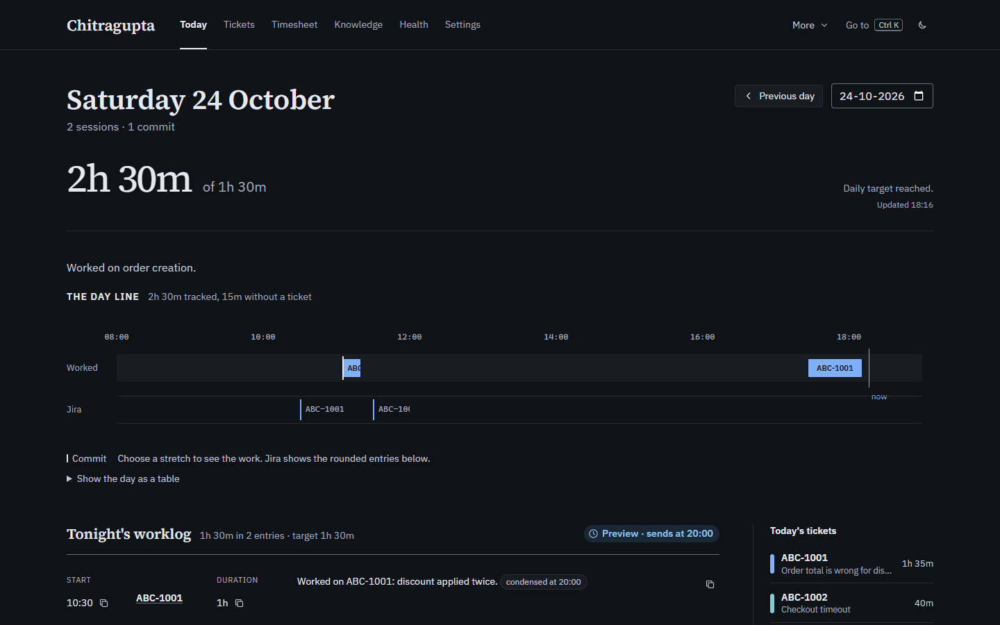

# Dashboard

The dashboard is a page served from your own machine. It shows what Chitragupta has recorded: today, your tickets, your timesheet, the knowledge it has gathered and its own health. It lives at `http://127.0.0.1:7419/` by default, works offline and only reads your data.

## Open it

| How | What happens |
|---|---|
| `/cg:dashboard [day YYYY-MM-DD\|today\|yesterday\|-N \| ticket KEY \| page]` | Starts the dashboard if it isn't running and opens it in your browser (`day -3` is three days back; an invalid date gets a message saying what works) |
| Start menu | Setup adds a **Chitragupta** shortcut to the Start menu. `… dashboard shortcut --desktop` adds one to the Desktop too. |
| As an app | In Chrome or Edge, use *Install Chitragupta* in the address bar (or *Apps → Install this site as an app*). It then opens in its own window and appears in the Start menu with Today, Tickets, Timesheet and Health as jump-list shortcuts. |
| Automatically | The `Chitragupta` scheduled task (at logon and every 5 minutes) and the SessionStart maintenance step (at most every 10 minutes) start it if it's down, or replace an older version. Turn this off with `dashboard.autostart: false` or `CHITRAGUPTA_DASHBOARD=0`. |

The command line, where `…` is the stable launcher `py -3 "$env:USERPROFILE\.chitragupta\runtime\run.py"`:

| Command | Does |
|---|---|
| `… dashboard open [ROUTE] [--no-browser]` | Starts it when needed (waits up to 6 s) and opens the page, for example `dashboard open tickets/ABC-1001` |
| `… dashboard ensure [--json]` | Starts it when needed and prints `Dashboard started: http://127.0.0.1:7419/` |
| `… dashboard stop [--json]` | Stops *our* server on the port. A foreign app on that port is left alone. |
| `… dashboard status [--json]` | Who answers on the port: `down`; `ours` (with version, pid and data home); or `foreign` |
| `… dashboard url [ROUTE]` | Prints a link |
| `… dashboard shortcut [--desktop]` | Writes the Start menu shortcut again (and one on the Desktop) |
| `… dashboard serve [--port N]` | Runs it in the foreground, for debugging |

The server runs detached and windowless. Its log is `<home>\.worklog\logs\dashboard.log`, cleared on each start. **One server per port:** the port is the lock. `/api/health` answers `{"app": "chitragupta", "version", "pid", "home"}`, and a newer plugin version replaces an older server. A server for a different data home, or another app on the port, is never touched; `ensure` says the port is taken, and you pick another with `dashboard.port`.

The installed app window and the shortcuts only work on this machine: the server listens on `127.0.0.1` and nowhere else. There is no offline copy of your data: when the server isn't running, the window says so instead of showing old numbers.

## Layout

- **Top navigation:** Today, Tickets, Timesheet, Knowledge, Health and Settings, with the current page underlined. Health shows a count of current problems. **More** opens DB map, Search, Team notes and Setup; below 1100 px, **Pages** contains all destinations. <kbd>[</kbd> toggles this menu; <kbd>Esc</kbd> closes it.
- **Go to:** opens the command palette (<kbd>Ctrl</kbd> <kbd>K</kbd>). The theme switch sits beside it.
- **Page layout:** quiet ruled sections, a full-width ticket table with filters above it, and a monthly calendar with selected-day details. Knowledge, Settings and other pages with a side list fold it into a *Show …* button below 1000 px.
- **Ticket evidence:** recorded sources sit beside each finding; a compact ticket switcher preserves quick access to other tickets.
- **Health and Settings:** Health opens with current problems and expandable component diagnostics. Unsaved settings appear in a sticky review bar; saving still requires the existing review step.

## Pages

| Route | Shows |
|---|---|
| `#/today` | A large tracked-time summary against the day's target; **the Day Line** with parallel Worked and Jira rows, selectable stretches of recorded activity and commit ticks (also as a table); ticket totals and delivery alerts in the margin; **tonight's worklog** with a copy button for each start, duration and description and *Copy all* for the whole message. Before 20:00 this is **the message the sender would send now**, built by the sender's own code from the latest Jira data and condensed lines it has: no Jira or model call, nothing saved. It says when the Jira data is from ("Jira data as of 19:40", or that there is none yet, so time already in Jira isn't subtracted) and marks each line that is still *condensed at 20:00*. **Refresh from Jira** (one read-only Jira call) and **Preview exactly** (one condensing call, whose lines the 20:00 message reuses) make it exact; both count against the daily MCP budget, keep the 20:00 calls in reserve, and can be hidden in Settings. Once the day is composed, it shows the saved message and whether it was sent; **Send again** queues one `resend:` for the next background run (a double click counts once). A past day whose activity is gone shows its totals without the times of day. |
| `#/day/YYYY-MM-DD` | Any past day: its timeline and entries, the message as it was sent (with its send history: every version, why it was sent and Slack's answer) or as it would be sent, the branch and PR events of that day, and the current alerts of that day's tickets. Move with the date picker, the previous and next buttons, or <kbd>p</kbd> / <kbd>n</kbd>. A day with nothing recorded says so. |
| `#/tickets` | Every ticket, sortable by key, title, status, last activity, time, findings and requests. Filter by text, status, repo, *only with delivery alerts* and last active; the filters live in the address, so a filtered list can be bookmarked. Long lists scroll without slowing down. |
| `#/tickets/ABC-1001` | One ticket with a header that stays in view (title, Jira status, repo and branch chips, time, alerts) and tabs: **Overview** (in short, the problem, findings grouped by kind: root cause, fix, decisions, open questions…), **Branches & PRs** (the branch graph, delivery matrix, branches and PRs; see [branch-tracking.md](branch-tracking.md)), **DB flow** (with the QA worked example), **Requests** (copy as curl), **Queries**, **Artifacts**, **Timeline** (each day links to that day) and **Notes** (the ticket's README and its files). *Export* and *Export to share* download the page as one HTML file. |
| `#/timesheet` | A month calendar shaded by hours against each day's target, with leave, half days, holidays and extra workdays named in each cell; click a day to see its tickets and **mark it** as leave, a half day, a holiday (with a name), an extra workday (weekends) or remove its mark: one line in `inbox.md`, the same as `/cg:log`, applied by the next background run. Weekly bars against the target, and hours per ticket by ISO week or month with *Download CSV*. |
| `#/knowledge` | **DB map:** the map of every table and link, zoom and pan; pick a table to see its columns, its neighbourhood and which links the QA link map verified. **APIs:** the catalog with method, path, host, direction, purpose and tickets, filterable. **Integrations.** |
| `#/db/<schema.table>` | **DB map:** databases → schemas → tables in the side list (search by name). Without a table: each database's schemas and table counts, and the whole map on request (*Draw every link*). With a table: its purpose, schema card and key columns; a **direct links** or **two hops** diagram (zoom and pan, *Show as text*); its links, each marked *verified* (80% or more of the QA link map's sampled rows matched), *likely* (30% or more) or *not verified* (seen in code or a session), with the row counts and evidence; its columns (type, primary/foreign key, personal data, nullable); who reads and writes it; its tickets and saved queries. Tables the link map and schema cards don't place go under *Seen in code or sessions*. |
| `#/team` | **Team notes:** every bundle in your share targets, yours and your teammates', newest first (yours marked); one opens as Markdown with the path of its `ticket.html`. Read-only. A ticket's **Share…** button opens the share dialog: pick sections, level and target, **Preview** (what each section loses, what is never included, the scan), then **Share**, enabled only after a preview that passed. See [sharing.md](sharing.md). |
| `#/search?q=` | Everything at once: tickets, findings, queries, requests, artifacts, branches, PRs, APIs, tables, DB links, integrations and daily notes, grouped by type with the matching words marked; each result shows its ticket and repo, and tables and DB links open in the DB map. **Filters** narrow it to a ticket, a repo or a date range, and live in the address (`#/search?q=&ticket=&repo=&from=&to=`). <kbd>↑</kbd> <kbd>↓</kbd> move through the results. See [Search](#search). |
| `#/health` | **Search index:** entries, when it was built and updated, and **Rebuild index**. **MCP status, live:** the same `claude mcp list` check `/cg:doctor` runs (no model call) runs when the page opens if the last one is over 5 minutes old, and on **Check now**; each server shows its live state (connected, signed out, unreachable, missing, switched off) with the check's time and duration, next to what the last background job saw (its state, unreachable or signed out, and the job's error text), its last error and the sign-in step to copy. A successful job clears the server's earlier offline mark, so the page never shows a server as connected and offline at once. The same panel is on Settings. Capture, background runs (with how the last hour's runs ended: ok, error, skipped while busy; see [scheduling.md](scheduling.md#run-records)), the daily push, Slack, the scheduled task, **Safety** (enforced or not, and every action the safety layer blocked in the last 24 h and 7 days, from `security.log`, plus how many other plugins' tool calls were skipped during `/cg:` commands, which aren't counted as blocks; see [safety.md](safety.md)), each configured MCP server (connected, signed out, missing or switched off, from the last cached `claude mcp list`), today's MCP jobs and tokens against the budget, warnings and recent errors. *Copy diagnostics* copies all of it as text. |
| `#/setup` | The `/cg:doctor` checks as a checklist, each with what to run to fix it |
| `#/settings` | Every setting Chitragupta lets you change from here, grouped (capture, daily worklog & Slack, Jira, database MCP, branches & PRs, artifacts, push, models & budget, data, dashboard), plus the locked items shown read-only and Appearance (per browser). Edits collect into a review (now → after saving) before **Save changes**; the change history lists every change and **Undo last change** reverts the newest one from this page. |

## Settings

- **One write path.** A save goes through `chitragupta/configstore.py`, the same code `/cg:setup` and the engine use: a lock (so two writers can't interleave), a backup of `config.json` under `.worklogackups\`, an atomic write, and one history line per changed key in `%USERPROFILE%\.chitragupta\settings-history.jsonl` (values of secret-looking keys are written as "(hidden)"). The engine saves only the keys it changed itself, onto the current file, so it never overwrites a change you just made.
- **One rulebook.** `chitragupta/settings.py` holds each setting's label, help, type and limits. The page checks as you type with the same rules, and the server checks again; anything not in the schema, or locked, is refused.
- **Locked, shown only:** the safety rules, MCP tools and their read/write class, secrets, the data folder, the GitHub repo, the backup folder and the MCP server names. `/cg:setup` changes those.
- **On/off switches** for the background work, each on unless you turn it off: Jira ticket cards and evening facts, the QA trace and the weekly link map, the daily push, request curation and artifacts.
- **Per repo** (Branches & PRs): the strategy, the branch names for each base role, how the bases relate (add, change or remove relations, or **Detect from the repo**: read-only git on local refs, no fetch, nothing saved until you review and save) and where PR information comes from.
- **Team sharing:** share targets (folders or team Git repos; never Slack), the default level and your name on shared notes. **Background job:** what is registered for this OS and whether it is current, with **Repair**; setup registers it and uninstall removes it.
- **Undo** reverts the newest change made from this page, and refuses when any of its settings changed again since.

## Search

One index serves the Search page, the command palette, `/cg:search` and the MCP server: `.worklog\cache\search.sqlite`, a local cache the background tick brings up to date after every render (only the files that changed are re-read). The dashboard only reads it: when the file is missing or a tick hasn't caught up yet, it answers from an up-to-date copy in memory and writes nothing. Results come grouped by type, best first, and a query that is exactly a ticket key puts that ticket first. Filter with `type`, `ticket`, `repo` and a date range (`from`, `to`) on `/api/search`. What is indexed, the ranking and rebuilding are in [search.md](search.md).

## Command palette

<kbd>Ctrl</kbd> <kbd>K</kbd> (or <kbd>/</kbd>) opens it from anywhere. Type part of a page, ticket, table, API or word: it lists matching pages, tickets and actions, then what search finds in your worklog. <kbd>↑</kbd> <kbd>↓</kbd> move, <kbd>Enter</kbd> opens, <kbd>Esc</kbd> closes. Actions: switch theme, show or hide the More / Pages menu, copy tonight's Jira message, download the timesheet CSV, show the keyboard shortcuts.

## Keyboard shortcuts

<kbd>?</kbd> lists them on any page. Shortcuts are off while you type in a field; <kbd>Ctrl</kbd> <kbd>K</kbd> always works.

| Keys | Does |
|---|---|
| <kbd>Ctrl</kbd> <kbd>K</kbd> or <kbd>/</kbd> | Command palette |
| <kbd>?</kbd> | Show the shortcuts |
| <kbd>g</kbd> then <kbd>t</kbd> · <kbd>k</kbd> · <kbd>s</kbd> · <kbd>n</kbd> · <kbd>b</kbd> · <kbd>f</kbd> · <kbd>m</kbd> · <kbd>h</kbd> · <kbd>u</kbd> · <kbd>e</kbd> | Today · Tickets · Timesheet · Knowledge · DB map · Search · Team notes · Health · Setup · Settings |
| <kbd>j</kbd> / <kbd>k</kbd> | Next / previous item in the side list |
| <kbd>[</kbd> | Show or hide the More / Pages menu |
| <kbd>c</kbd> | Today: copy the whole Jira message |
| <kbd>p</kbd> / <kbd>n</kbd> | Today and Timesheet: previous / next day or month |
| <kbd>1</kbd> … <kbd>8</kbd> | Ticket: switch tab |
| <kbd>←</kbd> <kbd>→</kbd> <kbd>Home</kbd> <kbd>End</kbd> | Within tabs and option groups |
| <kbd>+</kbd> <kbd>−</kbd> <kbd>0</kbd> and arrows | Within a focused diagram: zoom, reset, pan |
| <kbd>Esc</kbd> | Close a dialog |

## Live updates

The page keeps one Server-Sent Events connection (`/api/events`) open while the tab is visible. The server sends a new change cursor as soon as any file the page reads changes, and the page fetches again. It keeps your scroll position, focus, typed filters and open sections. If the stream can't connect, the page checks `/api/changes` every 10 seconds instead and keeps retrying the stream.

## Appearance and accessibility

- **Themes:** dark **Night ink** is the default for a browser without a saved preference. Saved Light and System choices are preserved. `?theme=light` or `?theme=dark` overrides the theme for that visit without saving it. The switch is in the top bar and on Settings. Density (comfortable or compact) and motion (system, reduce or full) are on Settings. Preferences are remembered in this browser only.
- **Fonts:** Source Serif 4 headings and IBM Plex Sans body text, served locally with system fallbacks. No external font requests. Ticket exports embed the fonts and include downloadable copies of their open licenses.
- **Keyboard:** a skip link, landmarks and one heading per page; every control can be reached and used from the keyboard with a visible focus ring; dialogs keep focus inside and give it back when closed; moving to a new page moves focus to its heading.
- **Screen readers:** tabs, dialogs, the palette (combobox and listbox) and option groups follow the WAI-ARIA patterns; copy confirmations and updates are announced in a polite live region; charts and diagrams have a table or text version next to them.
- **Never colour alone:** every status has an icon and a word.
- **Checked automatically:** every page in both themes against WCAG 2.2 AA with axe, at 1440, 1280 and 900 px, plus a keyboard walk (see [development.md](development.md#ui-checks)).

## API

The page uses these endpoints. Every one is GET/HEAD and returns JSON unless noted.

| Path | Returns |
|---|---|
| `/` | The page (`app/index.html`) |
| `/app/<file>` | The page's own scripts, styles and icons. Only files that exist under `chitragupta/dashboard/app/` with an allowed extension (`.js .css .svg .png .woff2 .webmanifest .json`) are served; anything else gets 404. |
| `/manifest.webmanifest` | The web app manifest |
| `/vendor/preact.module.js`, `/vendor/hooks.module.js`, `/vendor/mermaid.min.js` | Vendored libraries (see [THIRD_PARTY_NOTICES.md](../THIRD_PARTY_NOTICES.md)) |
| `/api/health` | App, version, pid and data home |
| `/api/today` | Today's tickets and minutes, the saved worklog or a preview, plus `lanes` (activity spans per ticket), `commit_list`, `sessions`, `last_activity`, `target_minutes` and `day_kind` |
| `/api/day/<YYYY-MM-DD>` | The same for any day. A past day's preview is composed for the whole day; a saved worklog still wins. A malformed date gets 400. |
| `/api/calendar?from=&to=` | Minutes per day and per ticket, each day's kind (`workday`, `weekend`, `leave`, `half_day`, `holiday`, `extra_workday`), its note and target. Default: the 365 days ending today; at most 400 days. |
| `/api/knowledge` | Tables (with columns from the QA schema cards), relations (`verified` when the QA link map confirmed them), the code that writes each table, APIs and integrations |
| `/api/db` | The DB map tree: databases → schemas → tables, each with its link and verified-link counts, plus totals and the link map's date |
| `/api/db/table?key=&hops=1\|2` | One table (a bare table name works when only one schema has it): columns, links with `status` and `ratio`, readers and writers, tickets, saved queries and its neighbourhood `graph`. Unknown: 404. |
| `/api/db/graph` | Every recorded link, for the whole-map diagram |
| `/api/scheduler` | The background job for this OS: method, installed, current, status, next run, detail |
| `/api/share` | Share sections, levels, targets (each with its problem) and the default level |
| `/api/share/preview?key=&sections=&level=` | The bundle as it would be shared; writes nothing. 400 for an unknown section, level or ticket. |
| `/api/team-notes`, `/api/team-notes/note?target=&dir=` | The team's bundles; one bundle's README (404 for anything that isn't a bundle) |
| `/api/search?q=&type=&ticket=&repo=&from=&to=&limit=` | Full-text search over every indexed type (see [search.md](search.md)), grouped by type. `type` is a comma-separated list; `ticket`, `repo` and the inclusive `from` / `to` dates (`YYYY-MM-DD`) narrow it; a malformed date gets 400. Each result has `type`, `ref`, `title`, `ticket`, `repo`, `date`, `href` (the page to open), `path` (the data-home file to read), a plain-text `snippet` and `hits` (offsets). |
| `/api/setup` | The setup checklist: each check's status (`ok`, `warn`, `bad`, `off`), detail and the fix to run. Built from `doctor --fast` and cached for 60 s. |
| `/api/events` | Server-Sent Events: a `cursor` event when the stream opens and whenever a file the page reads changes, and a keep-alive comment every 25 s. At most 16 open streams; more get 503 with `Retry-After: 5`. |
| `/api/tickets?q=` | Ticket list, with each ticket's branch alerts and first linked branches |
| `/api/tickets/<KEY>` | One ticket. A malformed key gets 400; an unknown key gets 404. Includes `git` (branches, PRs, delivery, alerts, and a Mermaid graph per repo) and `readme` (the ticket's `README.md`). |
| `/api/tickets/<KEY>/export?mode=full\|shareable` | The whole ticket page as one self-contained HTML file (attachment), built in memory: nothing is written. `shareable` applies the public redaction pass and drops QA values, PR and internal URLs, hosts and file paths. |
| `/api/timesheet?period=week\|month` | Hours table and calendar notes |
| `/api/timesheet.csv?period=` | CSV in long format (`period,ticket,title,minutes,hours`), UTF-8 with BOM. Values that look like spreadsheet formulas are escaped. |
| `/api/status` | Health page data, including `tick.recent` (the last 10 run records) and `tick.last_hour` (outcome → count), `mcp.live` (the last `claude mcp list` check that setup, doctor or maintenance cached; the dashboard never runs it; each server has `status`, `error`, `error_at`), `mcp.offline` (server → time a job last found it unreachable or signed out), `mcp.server_state` (server → `{state: unreachable\|signed-out\|missing, error, at}`), `mcp.job_errors` (job → `{error, at}`) and `search` (engine, units, sources, last build and update with their times, and whether this process reads the file or a copy in memory) |
| `/api/changes` | A cursor that changes when any file the page reads changes |
| `/api/settings` | The settings schema with current values, grouped, plus the last 20 history lines |
| `PATCH /api/settings` | `{"changes": {"dotted.key": value}}` → 200 `{"id", "changes"}`, or 422 `{"error", "fields": {key: message}}` with nothing saved |
| `POST /api/settings/undo` | Reverts the newest change from the dashboard; 409 when there is none or it would overwrite a newer change |
| `POST /api/actions/<name>` | `capture-pause`, `capture-resume`, `mcp-check` (the live `claude mcp list` check `/cg:doctor` runs; no model call), `worklog-refresh` and `worklog-exact` (`{"day"}` → `{ok, preview, skipped?}`; within the daily MCP budget; 403 when the preview buttons are off), `worklog-resend` (`{"day", "request_id"}` → one `resend:` line; a repeated id within 2 minutes counts once), `calendar-mark` (`{"day", "kind": leave|half-day|holiday|workday|clear, "name"?}` → one inbox line), `search-rebuild` (rebuilds the search index, the same as `/cg:search --rebuild`), `scheduler-repair` (re-registers the background job when it is missing or differs), `share-ticket` (`{"key", "sections", "level", "target"}`; the same as `cli share KEY --yes`), `relations-detect` (`{"repo"}` → proposed base relations from local refs; read-only, saves nothing) |

## Security model

The dashboard shows your worklog, so it is locked to your own browser on your own machine:

- **Bound to `127.0.0.1` only**, with exclusive address use, so it is never reachable from the network.
- **Host header check.** A request is answered only when its `Host` is exactly `127.0.0.1:<port>` or `localhost:<port>`. A missing Host is rejected. That blocks DNS-rebinding attacks. If an `Origin` header is present, it must match too.
- **Reads are GET/HEAD.** Every other method gets 405, except on the few write routes below.
- **Writes are an allowlist** (`chitragupta/dashboard/writes.py`): `PATCH /api/settings`, `POST /api/settings/undo` and `POST /api/actions/<name>` for the eleven allowlisted actions (capture pause/resume, the live MCP check, base-relation detection, calendar marks, the worklog refresh/exact preview/resend, search rebuild, scheduler repair and sharing a ticket; the full list with what each may write is in [safety.md](safety.md#the-dashboards-writes)). Each one must pass, in order: Host; an `Origin` that is this server (missing or `null` is refused); the `X-Chitragupta-Token` header carrying the random token minted when the server started (the page receives it in a `<meta>` tag, and other sites can't read the page); `Content-Type: application/json`; a `Content-Length` within the route's cap (16 KB); at most 30 writes a minute; a body that is a JSON object. Everything a write changes goes through the safety layer and is recorded in the settings history.
- **No CORS.** Other sites can't read responses.
- **Headers on every response, errors included:** a strict Content-Security-Policy, `X-Content-Type-Options: nosniff`, `X-Frame-Options: DENY`, `Referrer-Policy: no-referrer` and `Cross-Origin-Resource-Policy: same-origin`.
- **Scripts only from the server itself.** The Content-Security-Policy allows no inline script, no `eval`, no workers, no plugins and no external origins. Preact escapes every value it renders; the only raw HTML is the page's own Markdown renderer, which escapes its input first, and Mermaid's SVG (`securityLevel: strict`).
- **No file serving.** Only the page, the files under `app/` with an allowed extension and the vendored libraries are served. A request path is looked up as an exact key in a list built by walking `app/`; it is never joined onto a folder, so a crafted path can't reach any other file.
- **Search only reads.** The dashboard opens the search index read-only; when it is missing or behind, it answers from a copy in memory. Only the background tick and `/cg:search --rebuild` write it, through the safety layer's path guard. User input is always quoted, so it can't use FTS syntax.
- **Robust to bad input.** A malformed request gets an error status (400, 414 or 505), never a crash. Sockets time out after 15 s.
- **Shutdown is guarded.** `/api/shutdown` needs a random token that only your user account can read (`%USERPROFILE%\.chitragupta\dashboard\<port>.token`). `dashboard stop` uses it.
- **No outgoing requests.** The server doesn't call out, and the page doesn't either.

## Configuration

| Setting | Default | Meaning |
|---|---|---|
| `dashboard.port` (config) | `7419` | Port on `127.0.0.1` |
| `CHITRAGUPTA_DASHBOARD_PORT` (env) | — | Overrides the port |
| `dashboard.autostart` (config) | `true` | Start from the scheduled task and SessionStart maintenance |
| `CHITRAGUPTA_DASHBOARD` (env) | — | `0` / `off` turns autostart off |

## Ticket export

The same file comes from `/cg:ticket <KEY> --export [--mode shareable]`, which saves it under `tickets\<KEY>\exports\` (local only, never pushed; the nightly backup zip includes it). The file is the dashboard's own page with its styles and scripts inlined, the ticket's data, and Mermaid only when the ticket has a diagram (about 4 MB with it). It opens offline in any modern browser, has the same tabs, makes no requests (a Content-Security-Policy inside the file blocks them) and shows *Exported <date> · full|shareable*.

## Known gaps

- **MCP response times are per check, not per server.** `claude mcp list` reports one time for the whole check, so Health and Settings show that.
- **The Today preview is exact only when its data is.** Until the Jira data is refreshed and the marked lines are condensed (by the buttons, or by the sender at 20:00), it says which parts may still change.
- **The Markdown renderer is basic.** Links show as text.
